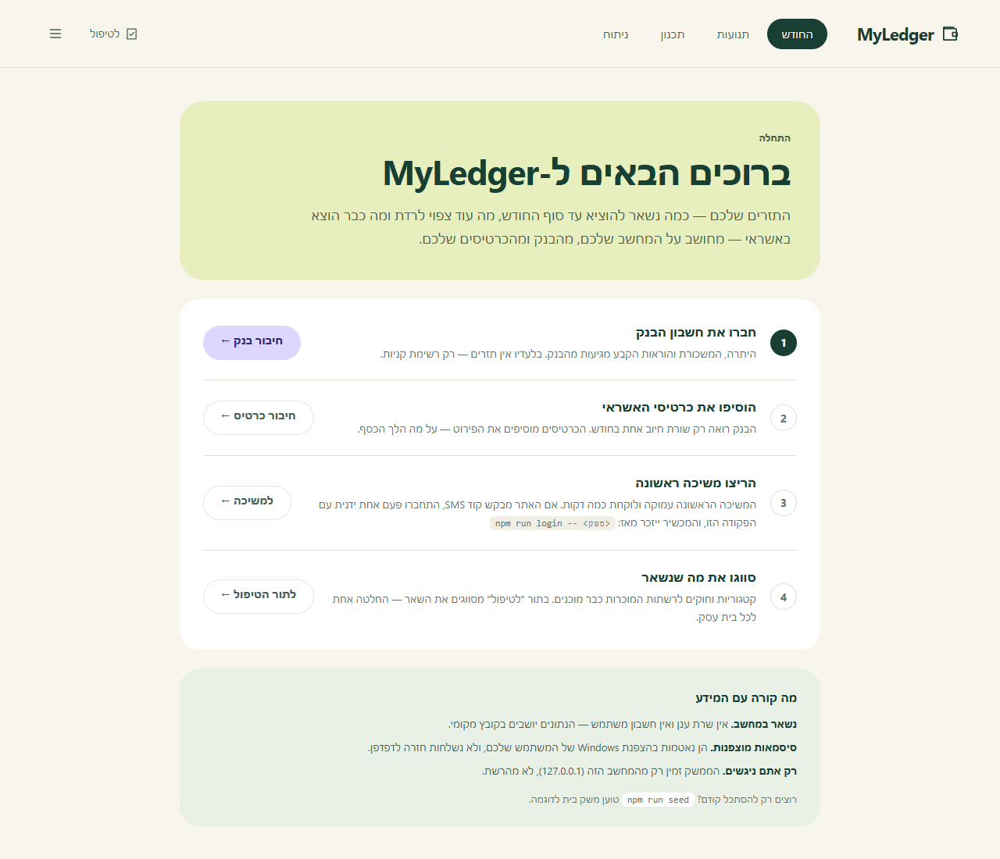

<div dir="rtl">

# מדריך התקנה

המדריך לוקח אתכם ממחשב נקי ועד מערכת שמושכת נתונים לבד כל יום. אפשר לעצור אחרי שלב 2 ולהסתכל על נתוני הדגמה, בלי לחבר שום חשבון אמיתי.

| שלב | מה | זמן |
|---|---|---|
| [1](#1-דרישות) | דרישות מקדימות | 5 דק׳ |
| [2](#2-התקנה) | התקנה בלחיצה כפולה והרצה ראשונה | 10 דק׳ |
| [3](#3-חיבור-חשבונות) | חיבור בנק וכרטיסי אשראי | 10 דק׳ לספק |
| [4](#4-משיכה-ראשונה) | משיכה ראשונה ובדיקה | 5–15 דק׳ |
| [5](#5-הרצה-קבועה) | הרצה קבועה ברקע | 2 דק׳ |
| [6](#6-הקשחה-מומלצת) | הקשחה, גיבוי, טלגרם | לפי הצורך |

---

## 1. דרישות

- **Windows 10 או 11.** הסיסמאות מוצפנות ב-Windows DPAPI והתזמון נרשם ב-Task Scheduler. במערכות אחרות אפשר להריץ את הממשק עם נתוני הדגמה, אבל לא לחבר חשבון אמיתי.
- **Node.js 22 LTS (לפחות 22.13) או 24 LTS**, עם עדכוני האבטחה האחרונים, מ-[nodejs.org](https://nodejs.org). אם הוא חסר, המתקין מציע להתקין אותו בשבילכם. Node.js 20 סיים תמיכה באפריל 2026.
- כ-**1GB פנוי**. ההתקנה מורידה Chromium, שבאמצעותו נמשכים הנתונים מאתרי הבנקים.

## 2. התקנה

### הדרך הפשוטה: לחיצה כפולה

1. בעמוד הפרויקט בגיטהאב: **Code ← Download ZIP**, וחלצו את הקובץ לתיקייה קבועה (למשל `Documents\MyLedger`).
2. לחיצה כפולה על **`install.cmd`**.

המתקין עושה את כל השאר:

| שלב | מה קורה |
|---|---|
| בדיקת Node.js | אם חסר או ישן — מציע להתקין (winget) או פותח את דף ההורדה |
| ספריות | מתקין את כל התלויות. בפעם הראשונה זה לוקח כמה דקות |
| מסד נתונים | יוצר את קובץ ההגדרות ואת מסד הנתונים |
| ממשק | בונה את הדשבורד |
| שאלה: נתוני הדגמה? | משק בית בדוי, כדי להסתכל לפני שמחברים חשבון אמיתי |
| שאלה: הרצה אוטומטית? | משיכה יומית ב-10:00 והפעלה עם Windows (שלב 5 למטה) |
| הפעלה | מפעיל את המערכת ופותח אותה בדפדפן |

**בפעמים הבאות:** לחיצה כפולה על **`start.cmd`** פותחת את המערכת (ומפעילה אותה אם היא כבויה). **לעדכון לגרסה חדשה:** מורידים את הגרסה החדשה לאותה תיקייה ומריצים שוב את `install.cmd`.

> Windows עשוי להציג "Windows protected your PC" בפעם הראשונה. זה קורה לכל קובץ שהורד מהאינטרנט ולא נחתם דיגיטלית: **More info ← Run anyway**. אפשר לפתוח את `install.cmd` ואת `scripts\install.ps1` בעורך טקסט ולראות בדיוק מה הם מריצים.

### הדרך הידנית

למי שמעדיף לראות כל שלב, או מתקין עם Git. פתחו PowerShell בתיקייה שבה תרצו שהמערכת תשב:

```powershell
git clone https://github.com/ilaykid/MyLedger.git
cd MyLedger
npm ci
npm run web:install
copy .env.example .env
npx prisma migrate deploy
npm run web:build
```

> **`npm ci` ולא `npm install`.** כל הגרסאות נעולות במכוון — כל חבילה בפרויקט יכולה בתיאוריה לקרוא את פרטי ההתחברות, ולכן עדכון תלויות הוא החלטה מודעת ולא תוצאת לוואי. ראו [SECURITY.md](../SECURITY.md).

### רוצים קודם להסתכל? נתוני הדגמה

```powershell
npm run seed
```

טוען משק בית בדוי: שני שכירים, שכר דירה, שני כרטיסי אשראי, תשלומים וחיובים דו-חודשיים. הפקודה **מסרבת לרוץ** ברגע שיש במערכת חשבון אמיתי, כדי שלא תמחק נתונים בטעות.

**לפני שמחברים חשבון אמיתי** מנקים את נתוני ההדגמה (הקטגוריות המוכנות חוזרות בהפעלה הבאה):

```powershell
npm run reset -- all
```

### הפעלה

```powershell
npm run api
```

ופתחו בדפדפן: **http://127.0.0.1:3010**

בלי נתוני הדגמה, המסך הראשון הוא מסך "ברוכים הבאים" שמוביל אתכם בשלבים הבאים. קטגוריות וחוקי סיווג לרשתות המוכרות נטענים אוטומטית בהפעלה הראשונה.



---

## 3. חיבור חשבונות

**התחילו מהבנק.** ממנו מגיעות היתרה, המשכורת והוראות הקבע — בלעדיו אין תזרים. אחר כך הוסיפו את כרטיסי האשראי, שנותנים את פירוט הקניות.

### דרך הממשק (מומלץ)

**חשבונות וחיבורים ← הוספת חיבור**, בוחרים ספק וממלאים את השדות שהוא מבקש. הפרטים מוצפנים בשרת **לפני** שהם נכתבים לדיסק, ולעולם לא נשלחים חזרה לדפדפן.

### דרך הטרמינל

```powershell
npm run accounts -- add
```

שואל שדה אחרי שדה ומסתיר את הסיסמה בזמן ההקלדה. פקודות נוספות: `npm run accounts` (רשימה ומצב הצפנה), `npm run accounts -- update`, `npm run accounts -- remove`.

### מזהי הספקים

| סוג | ספקים |
|---|---|
| בנקים | `hapoalim` `leumi` `discount` `mizrahi` `mercantile` `otsarHahayal` `beinleumi` `union` `massad` `yahav` `pagi` `oneZero` |
| אשראי | `visaCal` `max` `isracard` `amex` `behatsdaa` `beyahadBishvilha` |

הרשימה המלאה והשדות שכל ספק דורש: [`accounts.config.example.json`](../accounts.config.example.json). התמיכה בספקים מגיעה מ-[israeli-bank-scrapers](https://github.com/eshaham/israeli-bank-scrapers).

> **מומלץ מאוד: משתמש צפייה בלבד.** רוב הבנקים מאפשרים לפתוח משתמש נוסף שרואה תנועות ויתרות אבל לא יכול להעביר כסף. כך גם דליפה מלאה של הסיסמה לא מאפשרת להזיז שקל. פרטים ב-[SECURITY.md](../SECURITY.md#משתמש-צפייה-בלבד).

---

## 4. משיכה ראשונה

### התחברות ידנית חד-פעמית (כשיש SMS/OTP)

בנקים רבים מזהים "מכשיר חדש" ומבקשים קוד SMS, ולמשיכה האוטומטית אין דרך לענות עליו. לכן כל ספק מקבל פרופיל דפדפן קבוע, ומתחברים אליו פעם אחת ידנית:

```powershell
npm run login -- hapoalim
```

נפתח דפדפן רגיל. מתחברים, עונים על הקוד **ומסמנים "זכור את המכשיר"**. מאותו רגע המשיכות האוטומטיות עוברות בשקט.

### משיכה

בממשק: **חשבונות וחיבורים ← משיכה מכולם**, עם יומן התקדמות חי. או בטרמינל:

```powershell
npm run scrape              # כל הספקים שהגיע זמנם
npm run scrape -- max       # ספק אחד, מיד
```

> ארגומנטים הם **מילים ולא דגלים** (`npm run scrape -- max`, לא `--company max`). npm בולע דגלים גם אחרי `--`, והסקריפט היה רץ בשקט על הכול.

המשיכה הראשונה של כל ספק עמוקה (`SCRAPE_MONTHS_BACK` ב-`.env` — 12 חודשים בקובץ הדוגמה). הבאות מרעננות רק את שלושת החודשים האחרונים.

### בדיקה אחרי החיבור הראשון

```powershell
npm run audit
```

מוודא שחיובי האשראי המרוכזים בבנק (״חיוב כרטיס אשראי 5,652 ₪״) מסווגים כהעברה ולא נספרים פעמיים — פעם כקניות בכרטיס ופעם כשורה בבנק. כל בנק מנסח את החיוב אחרת, והבדיקה מזהה אותם לפי **סכום**, לא לפי טקסט.

---

## 5. הרצה קבועה

```powershell
npm run schedule:check      # מה ייעשה, בלי לשנות כלום
npm run schedule:install    # רישום שתי המשימות
```

| משימה | מתי | מה |
|---|---|---|
| **MyLedger daily sync** | כל יום ב-10:00 | משיכה ← גיבוי ← סיכום בטלגרם |
| **MyLedger dashboard** | בכל כניסה ל-Windows | מחזיק את הממשק חי ברקע, בלי חלון |

- יום שבו המחשב היה כבוי **מושלם כשהוא נדלק** ולא נמחק.
- שעה אחרת: `npm run schedule:install -- 08:30`.
- המשימות רצות **תחת המשתמש שלכם**, לא כ-SYSTEM — אחרת לא היה אפשר לפענח את הסיסמאות.
- הסרה: `npm run schedule:remove`. מצב: `npm run schedule:status`.

**כל כמה זמן נכנסים לבנק?** כרטיסי אשראי — פעם ב-20 שעות. בנקים — פעם ב-48 שעות. אפשר לשנות לכל ספק (`everyHours` ב-`accounts.config.json`). לחיצה על "משיכה" בממשק רצה תמיד מיד.

---

## 6. הקשחה מומלצת

### אבטחה

```powershell
npm run secure          # מצפין סיסמאות שנשארו גלויות ומאמת הרשאות קבצים
npm run secure:check    # בודק את כל ההנחות: הצפנה, gitignore, פורט, תלויות
```

ומעבר לקוד: **BitLocker** על הדיסק ו**משתמש צפייה בלבד** בבנק.

### התקנה מוגנת (אופציונלי)

```powershell
npm run deploy:local
npm run schedule:install
```

מעתיק גרסה בנויה של המערכת ל-`%LOCALAPPDATA%\MyLedger\app`, ואת הנתונים ל-`%LOCALAPPDATA%\MyLedger\data` עם הרשאות קבצים למשתמש שלכם בלבד. תיקיית הקוד נשארת לפיתוח ולעדכונים, והמערכת שרצה מופרדת ממנה. אחרי ההעברה ההגדרות נערכות ב-`%LOCALAPPDATA%\MyLedger\data\.env`.

### גיבוי מוצפן

**הגדרות ← גיבוי מוצפן**, או:

```powershell
npm run backup -- init      # בוחרים תיקייה (למשל OneDrive) ומקבלים סיסמה — פעם אחת
npm run backup -- verify    # מוודא שהגיבוי האחרון באמת נפתח
```

הגיבוי מוצפן ב-AES-256-GCM לפני שהוא נוגע ביעד, ולכן מותר לשמור אותו בענן. **את הסיסמה שמרו במנהל סיסמאות** — בלעדיה אי אפשר לפתוח אותו. הגיבוי רץ אוטומטית אחרי כל משיכה יומית.

### סיכומים בטלגרם

המערכת יכולה לשלוח לכם כל בוקר הודעה לטלגרם: כמה יצא אתמול, התראות תקציב, ובעיות סנכרון אם היו. כך רואים את המצב מהטלפון בלי לפתוח את המחשב. זה לא חובה — הכול עובד גם בלי.

ההודעות נשלחות דרך **בוט פרטי שאתם יוצרים** בטלגרם (לוקח כ-2 דקות). הבוט שייך רק לכם, ורק מי שתוסיפו יקבל ממנו הודעות.

#### שלב 1: יצירת הבוט בטלגרם
1. בטלגרם, חפשו את **[@BotFather](https://t.me/BotFather)** (עם וי כחול) ופתחו איתו צ׳אט.
2. שלחו לו: `/newbot`
3. הוא ישאל **שם לבוט** — כל שם, למשל `הכסף שלי`.
4. הוא ישאל **שם משתמש לבוט** — חייב להיות ייחודי ולהסתיים ב-`bot`, למשל `my_ledger_2026_bot`.
5. תקבלו הודעה עם **טוקן** — שורה ארוכה שנראית כך: `1234567890:AAH...`. העתיקו אותה.

> הטוקן הוא כמו סיסמה לבוט. אל תשלחו אותו לאף אחד. במערכת הוא נשמר מוצפן.

#### שלב 2: חיבור הבוט למערכת
1. במערכת: **תפריט ☰ ← הגדרות ← התראות בטלגרם**.
2. הדביקו את הטוקן בשדה **Bot token**.
3. בטלגרם, פתחו את הבוט החדש (הקישור מופיע בהודעה של BotFather) ולחצו **Start** (או שלחו `/start`).
4. חזרו למערכת ולחצו **"זהה אותי"** — מספר הצ׳אט שלכם יתמלא לבד.
5. לחצו **"שמירה ובדיקה"**. תוך כמה שניות תגיע לטלגרם הודעת בדיקה. אם הגיעה — סיימתם.

#### שלב 3: בחירה כמה פרטים יוצאים
אחרי החיבור מופיעה ההגדרה **"כמה מידע יוצא בהודעה"**:

| רמה | דוגמה בהודעה | מתאים ל |
|---|---|---|
| **מלא** | `🛒 שופרסל דיל — 287 ₪` | הכי שימושי |
| **בלי שמות ספקים** | `🛒 סופר וקניות לבית — 287 ₪` | אם לא רוצים שמות חנויות בטלגרם |
| **מינימלי** | `יצאו 1,240 ₪ ב-6 תנועות` | הכי פרטי |

למה זה חשוב: צ׳אטים עם בוטים בטלגרם **אינם מוצפנים מקצה לקצה**, כלומר ההודעות שמורות גם בשרתים של טלגרם.

#### שלב 4 (לא חובה): הוספת בן/בת זוג
1. שלחו להם את הקישור לבוט, ובקשו שילחצו **Start**.
2. במערכת, תחת **"מי מקבל את ההודעות"**, לחצו **"מי כתב לבוט"** ובחרו אותם.
3. נשלחת אליהם הודעת בדיקה, ורק אם היא הגיעה הם נוספים לרשימה.

כל הנמענים מקבלים אותן הודעות ובאותה רמת פירוט. הם **לא** יכולים לשלוט במערכת או לשאול את הבוט שאלות — הבוט רק שולח.

#### מתי מגיעות הודעות
| מתי | מה |
|---|---|
| **כל בוקר** | סיכום יומי: מה יצא אתמול, תקציבים שמתקרבים לגבול, בעיות סנכרון, ומשכורת שנכנסה ("בערך כמו תמיד") |
| **יום ראשון** | סיכום שבועי: לאן הלך הכסף לפי קטגוריות, ותובנות (חיוב כפול, מנוי שהתייקר, בית עסק חדש) |
| **1 בחודש** | סיכום חודשי: האם החודש נגמר בפלוס או במינוס, מול החודש הקודם ומול הממוצע |

ההודעות נשלחות **על ידי המשימה היומית** (שלב 5), אחרי המשיכה. בלי המשימה אפשר לשלוח ידנית: כפתורי **"סיכום יומי" / "שבועי" / "חודשי"** בהגדרות, או `npm run notify`. לצפייה בהודעה בלי לשלוח: `npm run notify:preview`.

#### בעיות נפוצות
| מה קורה | מה לעשות |
|---|---|
| "זהה אותי" לא מוצא כלום | לא נשלח `/start` לבוט. פתחו את הבוט, לחצו Start, ונסו שוב |
| "Unauthorized" | הטוקן לא הועתק במלואו. העתיקו שוב מההודעה של BotFather |
| הגיעה הודעת בדיקה, אבל אין הודעות בבוקר | המשימה היומית לא רשומה: `npm run schedule:install` |
| הטוקן דלף | אצל @BotFather: `/revoke`, ואז חברו מחדש עם הטוקן החדש |
| רוצים להפסיק | **הגדרות ← התראות בטלגרם ← ניתוק** |

**אבטחה:** החיבור לטלגרם הוא **יוצא בלבד** — המחשב שולח הודעות, ושום דבר שנשלח לבוט לא מפעיל פעולה במערכת. אין פורט פתוח ואין גישה מבחוץ.

### הצעות סיווג ממודל מקומי

```powershell
ollama pull gemma2:9b
```

ואז ב**חוקי סיווג ← הצע סיווגים**. המודל רץ על המחשב בלבד (הקוד מסרב לכתובת שאינה localhost), מקבל רק שמות בתי עסק, ומציע **חוקים** שאתם מאשרים — הוא לא מתייג תנועות בעצמו.

---

## עדכון לגרסה חדשה

```powershell
npm run backup                 # אם הגדרתם גיבוי
git pull
npm ci
npm run web:install
npx prisma migrate deploy
npm run web:build
npm run deploy:local           # רק אם השתמשתם בהתקנה המוגנת
```

המיגרציות מוסיפות בלבד ולא מוחקות נתונים.

## הסרה

```powershell
npm run schedule:remove
```

ואז מחקו את תיקיית הפרויקט, ואם השתמשתם בהתקנה המוגנת — גם את `%LOCALAPPDATA%\MyLedger`. בבנק: מחקו את משתמש הצפייה או החליפו סיסמה, ו"התנתקו מכל המכשירים" באזור האישי.

## פתרון תקלות

| תסמין | מה לעשות |
|---|---|
| `Port 3010 is already in use` | המערכת כבר רצה (כנראה המשימה המתוזמנת). פתחו את http://127.0.0.1:3010, או הגדירו `API_PORT` אחר. |
| המשיכה נכשלת עם `INVALID_PASSWORD` | שמות השדות שונים בין ספקים — בדקו מול `accounts.config.example.json` ועדכנו בממשק. |
| `GENERIC` / `TIMEOUT` עם "Failed to fetch" | חסימת בוטים זמנית (Cloudflare). **המתינו כ-10 דקות** ונסו פעם אחת — ניסיונות חוזרים מאריכים את החסימה. |
| `GENERIC` אחר | כנראה אתגר SMS/"מכשיר חדש": `npm run login -- <ספק>` ואז שוב. לצפייה במה שקורה: `SCRAPER_SHOW_BROWSER=true` ב-`.env`. |
| `The browser profile … is already in use` | נשאר פתוח חלון מ-`npm run login`. סגרו אותו ונסו שוב. |
| `Could not decrypt a stored credential` | הקובץ הועתק ממשתמש או ממחשב אחר — DPAPI קשור לחשבון Windows. הזינו את הסיסמאות מחדש. |
| חיוב אשראי נספר כהוצאה | `npm run audit` יראה איפה. הוסיפו חוק שמסווג את נוסח החיוב של הבנק שלכם כ"העברות וחיובי אשראי". |
| `npm run seed` מסרב | יש במערכת חשבון אמיתי, והפקודה מוחקת הכול. זו ההגנה, לא באג. |

</div>
