

# מדריך שימוש

MyLedger עונה בעיקר על שאלה אחת: **כמה נשאר לי להוציא עד סוף החודש — ומה עוד צפוי לרדת?** כל מסך במערכת הוא דרך אחרת להגיע לתשובה הזו, לבדוק אותה או לדייק אותה.

- [חמישה מושגים שכדאי להכיר](#חמישה-מושגים-שכדאי-להכיר)
- [החודש — המסך הראשי](#החודש)
- [תכנון](#תכנון)
- [תנועות](#תנועות)
- [ניתוח](#ניתוח)
- [לטיפול](#לטיפול)
- [תפריט הניהול](#תפריט-הניהול): חשבונות, התחייבויות, קטגוריות, חוקים, היסטוריה, הגדרות
- [סיכומים בטלגרם](#סיכומים-בטלגרם)
- [שגרת שימוש מומלצת](#שגרת-שימוש-מומלצת)
- [פקודות טרמינל](#פקודות-טרמינל)

---

## חמישה מושגים שכדאי להכיר

**1. מחזור.** ברירת המחדל היא חודש קלנדרי רגיל. אם המשכורת נכנסת רחוק מה-1, אפשר לעגן את המחזור ליום המשכורת (למשל מה-9 עד ה-8) ב**הגדרות ← יום פתיחת המחזור**.

**2. סוג הכסף.** כל קטגוריה שייכת לאחד מהסוגים האלה, והסוג הוא שקובע את התחזית:

| סוג | דוגמה | מה המערכת עושה איתו |
|---|---|---|
| הכנסה קבועה | משכורת, קצבאות | צופה שתיכנס שוב |
| הכנסה משתנה | החזר מס, בונוס | סופרת כשנכנסה, לא מבטיחה שתחזור |
| הוצאה קבועה | שכר דירה, ביטוח, מנויים | התחייבות — יורדת מהמסגרת מראש |
| הוצאה משתנה | סופר, מסעדות, דלק | **זה מה שבשליטתכם** |
| הפקדה לחיסכון | הוראת קבע לפיקדון | יורדת מהמסגרת, אבל נספרת כהישג ולא כהוצאה |
| העברה | חיוב כרטיס אשראי בבנק, העברה בין חשבונות שלכם | לא נספרת בשום סיכום — כדי שלא תיספר פעמיים |
| לא תזרימי | פירעון משכנתא חד-פעמי, משיכה מהשקעה | כסף אמיתי שלא שייך לקצב החודשי — מוצג, אבל לא מעוות את התחזית |

**3. שתי תצוגות לאותו כסף.** קנייה באשראי ב-5 בחודש יורדת מהבנק רק ב-10 בחודש הבא. ב**תצוגה החשבונאית** ("מה הוצאתי") היא נספרת ביום הקנייה; ב**תצוגת המזומן** ("מה יהיה בבנק") ביום החיוב. המסכים אומרים תמיד באיזו תצוגה הם.

**4. צף האשראי.** כסף שכבר הוצא בכרטיס אבל עוד לא ירד מהבנק. זו הסיבה שיתרת הבנק נראית טוב יותר מהמצב האמיתי, ולכן המערכת מציגה אותו במפורש.

**5. פריסה.** בונוס שנתי או תשלום מראש לכמה חודשים נכנסים בפעם אחת. אם סופרים אותם כולם בחודש שבו נכנסו, החודש הזה נראה מצוין והבאים נראים כמו קריסה. פריסה מחלקת סכום כזה על פני כמה חודשים **בתצוגה החשבונאית בלבד** — היתרה בבנק לא משתנה.

---

## החודש

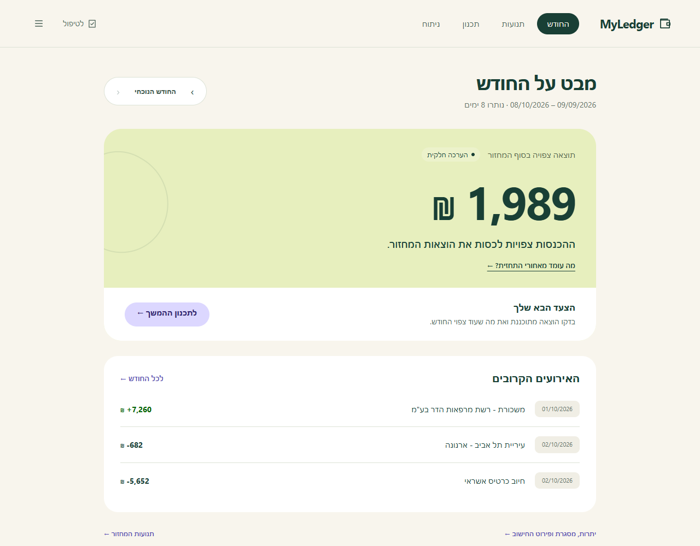

- **המספר הגדול** — התוצאה הצפויה בסוף המחזור: הכנסות (שנכנסו + שצפויות) פחות הוצאות קבועות, משתנות וצפויות. מתחת: משפט אחד שאומר אם זה חיובי או שלילי.
- **התווית ליד הכותרת** ("לפי הנתונים המתועדים" / "הערכה חלקית") — כמה אפשר לסמוך על המספר. לחיצה מובילה לבדיקת הנתונים.
- **"מה עומד מאחורי התחזית?"** — פותח את המשוואה המלאה, וכל שורה בה מקשרת לתנועות שמרכיבות אותה.
- **הצעד הבא** — אם יש בעיה בנתונים (ספק שלא התעדכן, חיוב אשראי שלא הותאם), תופיע כאן הפניה לתיקון. אם הכול תקין — הפניה לתכנון.
- **האירועים הקרובים** — ההכנסות וההוצאות הקבועות הבאות, עם תאריך צפוי.
- **החלפת מחזור** (למעלה משמאל) — חזרה אחורה עד 36 מחזורים.

**"יתרות, מסגרת ופירוט החישוב"** מוביל למסך המפורט:

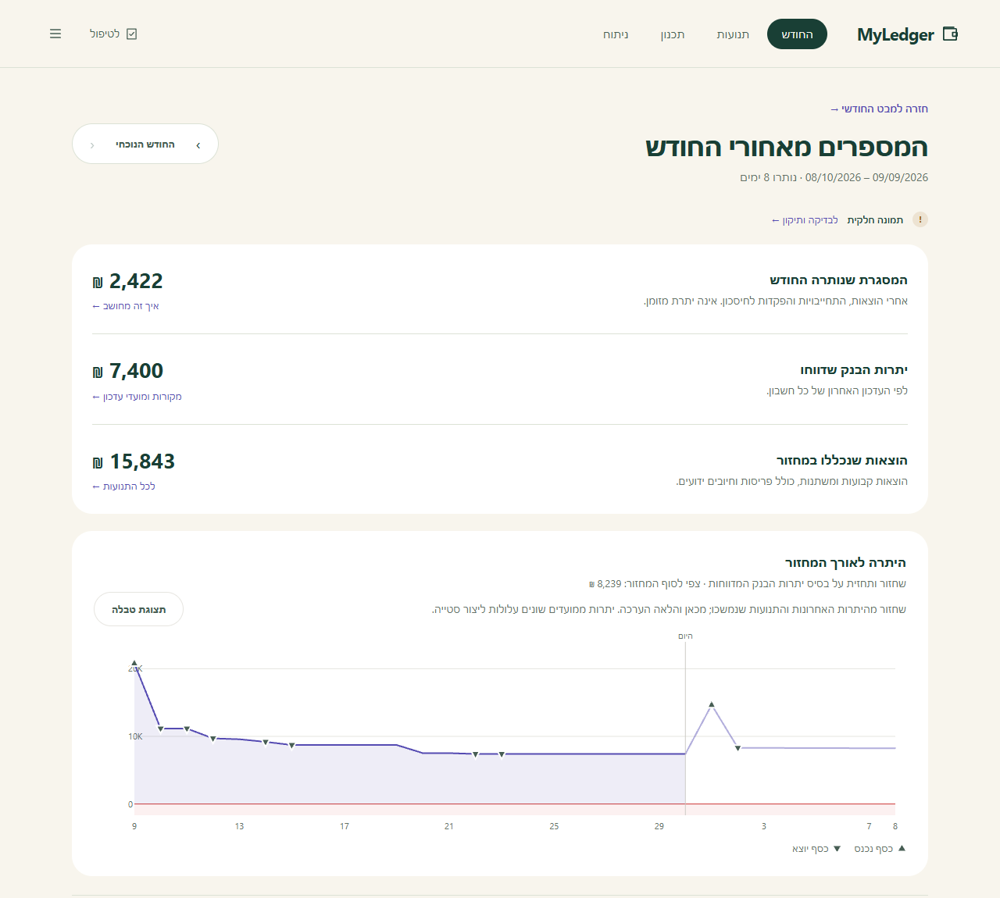

- **המסגרת שנותרה** — כמה עוד אפשר להוציא על הוצאות משתנות במחזור, אחרי כל ההתחייבויות והחיסכון. *זו לא יתרת הבנק.*
- **יתרות הבנק** — מה שדווח בעדכון האחרון של כל חשבון, עם מועד העדכון.
- **היתרה לאורך המחזור** — גרף יום-אחרי-יום: קו מלא עד היום, תחזית מהיום. אפשר לעבור עליו עם העכבר או עם **החצים במקלדת**, ויש **תצוגת טבלה** עם כל הערכים. משולשים מסמנים כסף שנכנס (▲) ויוצא (▼), ואזור אדום מסמן סכנת מינוס.
- **לאן הלכו ההוצאות המשתנות** ו**מגמות** של 12 חודשים — האם חודש חריג הוא מקרה או מגמה.

## תכנון

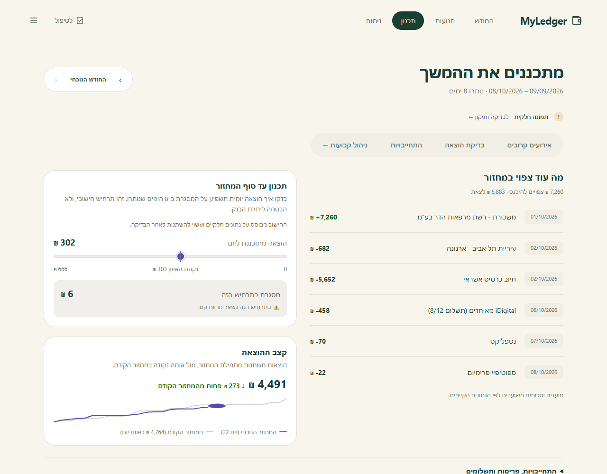

- **מה עוד צפוי במחזור** — כל ההכנסות וההוצאות הקבועות שעוד לא הגיעו.
- **תכנון עד סוף המחזור** — סליידר: "אם אוציא X ליום, כמה יישאר?", עם **נקודת האיזון** מסומנת.
- **קצב ההוצאה** — ההוצאות המשתנות מתחילת המחזור, מול אותה נקודה במחזור הקודם.
- **התחייבויות, פריסות ותשלומים** —
  - **תשלומים**: כל רכישה בתשלומים, כמה שולם מכמה, ובעיקר **לוח השחרור** — כמה כסף מפסיק לרדת בכל חודש.
  - **צף האשראי** לפי כרטיס ומועד חיוב.
  - **פריסות** פעילות, עם אפשרות להוסיף הערה.

## תנועות

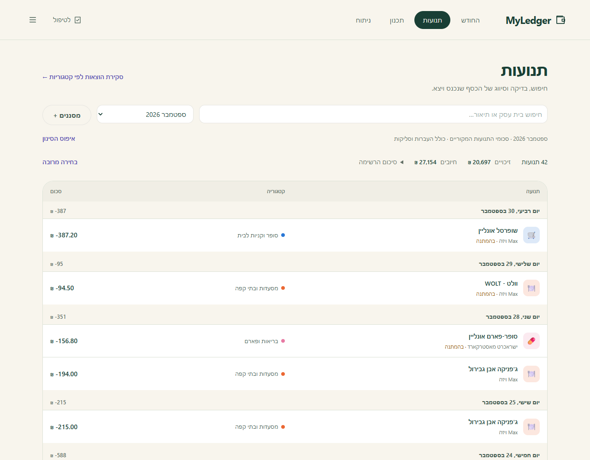

- התנועות **מקובצות לפי יום**, עם סיכום היום (בלי חיובי אשראי מרוכזים, שכבר נספרו כקניות).
- **חיפוש** לפי שם בית עסק, ו**בחירת חודש**. **מסננים**: חשבון, קטגוריה, טווח תאריכים, מצב (הושלם / בהמתנה), טווח סכומים, והשפעה על התזרים.
- **בחירה מרובה** — מסמנים כמה תנועות ומסווגים את כולן יחד. לפני השינוי מוצגת **תצוגה מקדימה** של מה ישתנה.
- **לחיצה על תנועה** פותחת את הפרטים:
  - **קטגוריה** — שינוי ידני *נועל* את התנועה, וחוקים אוטומטיים לא ידרסו אותו.
  - **למה סווגה כך** — ידנית, לפי איזה חוק, או ללא סיווג.
  - **הערה** בשלוש רמות: לתנועה הזו בלבד, **לכל התשלומים** של אותה רכישה (כולל עתידיים), או **לכל התנועות מבית העסק** (גם עתידיות). ההערה הספציפית גוברת.
  - **פריסה על פני חודשים** — עם תצוגה של הסכום לחודש והחודשים המדויקים לפני השמירה.
  - **חוקים שמתאימים לתיאור** — וקישור לעריכתם.

## ניתוח

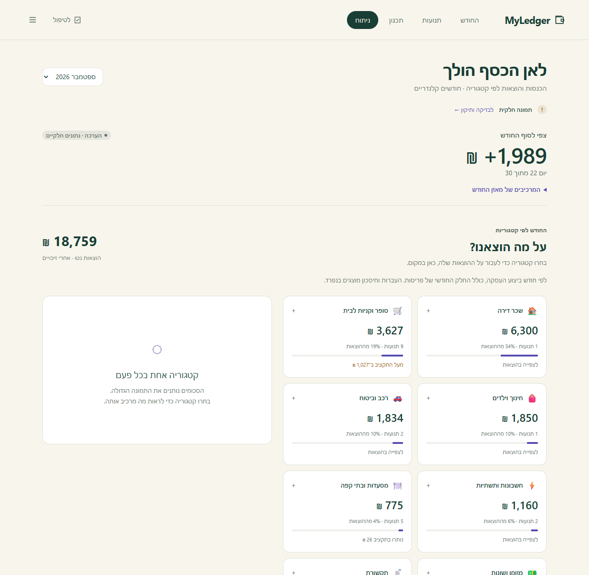

לפי **חודש קלנדרי**. למעלה — התוצאה הצפויה לסוף החודש ומרכיביה. מתחת — כרטיס לכל קטגוריה: כמה יצא, כמה תנועות, איזה חלק מההוצאות, ומצב התקציב **בשקלים** ("נותרו 26 ₪", "מעל התקציב ב-1,027 ₪") ולא באחוזים. לחיצה על קטגוריה מציגה את התנועות שלה באותו מקום. בהמשך: ההכנסות, ההפקדות לחיסכון וסיכום התקציבים.

## לטיפול

תור עבודה שאפשר **לסיים**. שלוש לשוניות:

**איכות וסנכרון** — האם המספרים שלמים:
- **התאמת חיובי אשראי**: לכל מחזור חיוב, האם הסכום שירד מהבנק שווה לסכום הקניות בכרטיס. אי-התאמה מצביעה על תנועות חסרות או על כרטיס שלא מחובר.
- **ממצאים**: ספק שהפסיק להתעדכן, חברת אשראי שמחייבת את הבנק אבל לא מחוברת, חיוב אשראי שנספר כהוצאה ועוד. לכל ממצא — ראיות, קישור לתנועות, ואפשרות לסמן "נבדק" עם הסבר. ממצא שסומן לא חוזר, אלא אם משהו השתנה.

**סיווג תנועות** — כרטיס אחד בכל פעם:

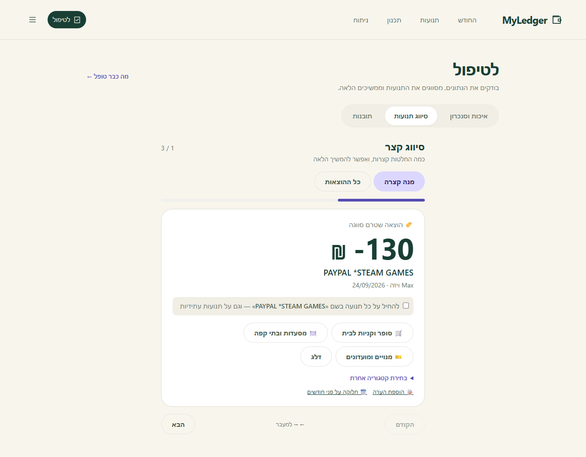

- בוחרים קטגוריה בלחיצה (ההצעות מסוננות לפי כיוון התנועה).
- **"להחיל על כל תנועה בשם הזה"** — יוצר חוק, וכל התנועות העתידיות מבית העסק יסווגו לבד. כך כל בית עסק דורש החלטה **אחת**.
- תנועה גדולה מאוד בבנק (25,000 ₪ ומעלה, למשל העברה להשקעה או משכורת עם בונוס) לא מסווגת אוטומטית לפי הגודל שלה: היא מופיעה ב**איכות וסנכרון** כתנועה מהותית שממתינה להחלטה — משכורת, העברה פנימית, חיסכון או "לא תזרימי".
- תנועה בהמתנה מסומנת: אם תחכו יום-יומיים, השם הסופי שלה עשוי להשתנות.

**תובנות** — בדיקות דטרמיניסטיות, לא ניחושים: **חיוב כפול** (אותו סכום, אותו בית עסק, תוך 3 ימים), **מנוי שהתייקר**, **חיוב חריג** (פי 2.5 מהרגיל), **בית עסק חדש** (גם סימן אזהרה להונאה), **קטגוריה מול עצמה** בחודשים קודמים, ו**תשלומים שמסתיימים**. אפשר לסמן כל תובנה כמועילה, לא רלוונטית, טופלה או "הזכר לי בעוד שבוע".

---

## תפריט הניהול

כפתור ☰ בפינה פותח את המסכים שמשתמשים בהם פחות:

### חשבונות וחיבורים
כל ספק, החשבונות שנמשכו ממנו, מתי עודכנו, כמה תנועות, היתרה והסכום שממתין לחיוב. מכאן **מוסיפים חיבור**, **מושכים** (לכולם או לספק אחד, עם יומן חי), מעדכנים סיסמה, משנים שם, קובעים **יום חיוב** לכרטיס, ומסמנים חשבון כ**רדום** (לא יתריע על חוסר עדכון) או **סגור** (נשאר בהיסטוריה, לא נכנס לתחזית).

### התחייבויות
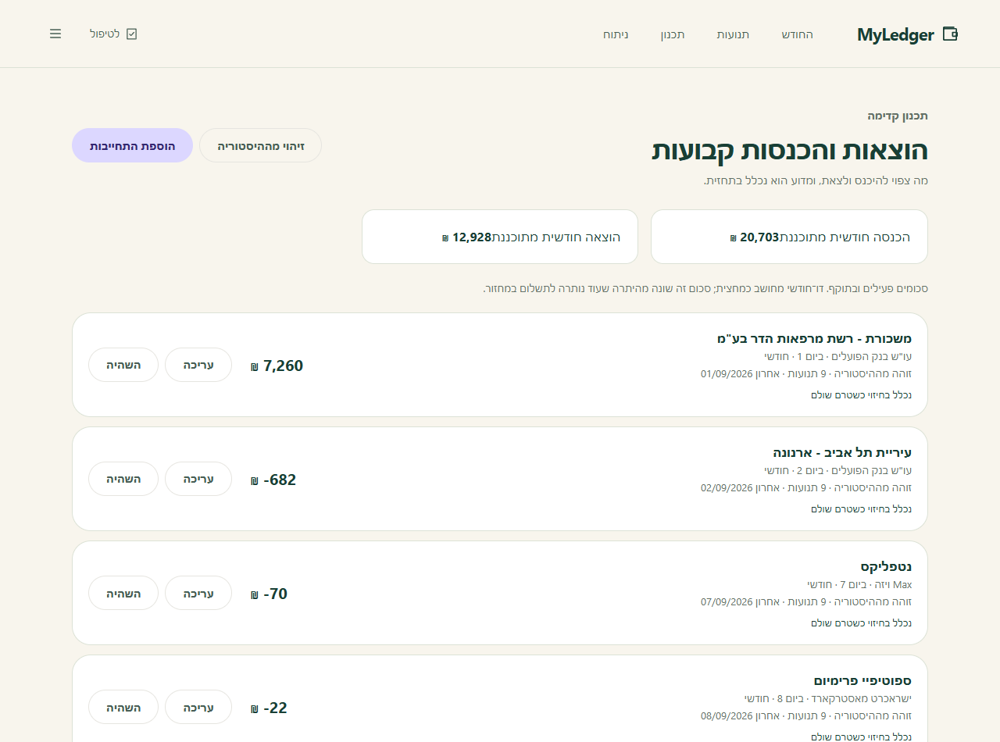

ההכנסות וההוצאות הקבועות. רובן **מזוהות אוטומטית** מההיסטוריה (כולל חשבונות דו-חודשיים כמו חשמל ומים), ואפשר גם להוסיף ידנית. לכל התחייבות: סכום צפוי, יום בחודש, תדירות, תוקף (מתאריך / עד תאריך), ומצב — פעילה, עתידית, פגה, או "לא נראתה לאחרונה".

### קטגוריות ותקציבים
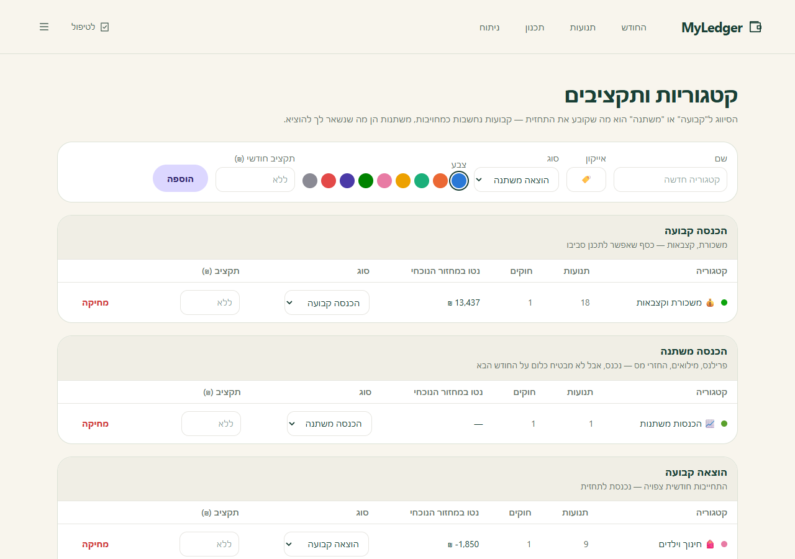

הקטגוריות מקובצות לפי סוג. לכל אחת: צבע, אייקון, סוג ו**תקציב חודשי** (לא חובה). **שינוי הסוג משנה את התחזית** — זו ההחלטה החשובה במסך הזה. בהתקנה חדשה נטענות אוטומטית 19 קטגוריות וחוקים לרשתות המוכרות בישראל.

### חוקי סיווג
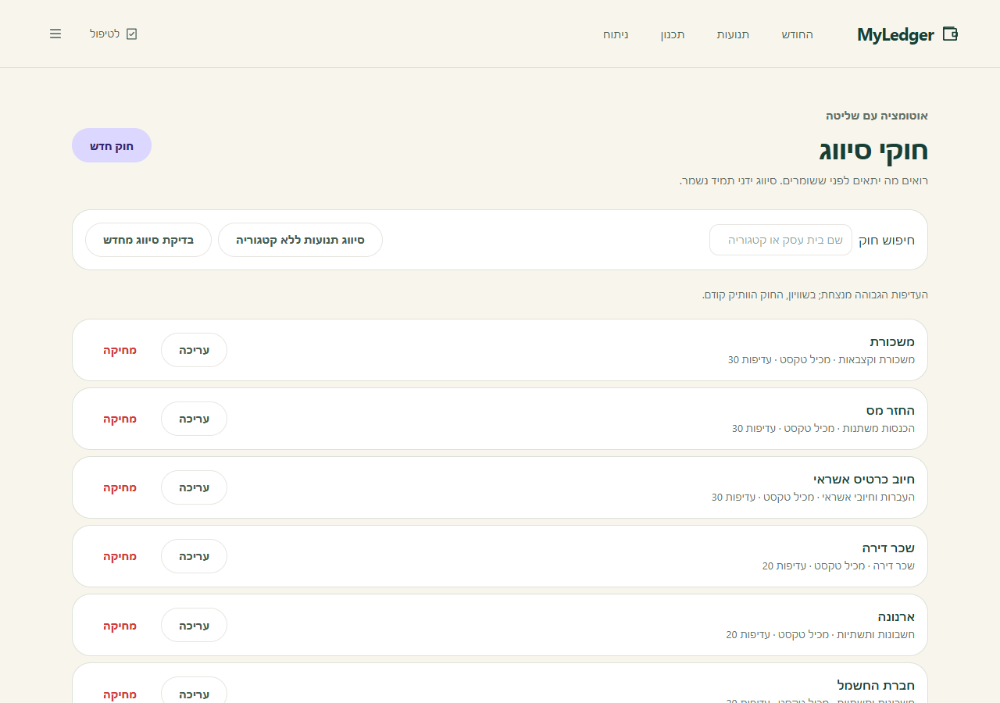

חוק = "אם התיאור מכיל X, הקטגוריה היא Y". אפשר גם ביטוי רגולרי (עם הגנה מפני ביטויים שיתקעו את המערכת). **עדיפות** גבוהה מנצחת. לפני שמירה מוצגת **תצוגה מקדימה**: כמה תנועות יתאימו, כמה מהן נעולות ידנית, וכמה מתנגשות בחוק אחר. תנועה שסווגה ידנית לעולם לא נדרסת.

**הצע סיווגים לבתי עסק לא מוכרים** — אם מותקן Ollama, מודל מקומי מציע חוקים לבתי העסק שנשארו, ואתם מסמנים את מה שנכון.

### היסטוריית שינויים
כל סיווג, חוק או שינוי קטגוריה נרשם, ואפשר **לבטל** אותו — כל עוד הנתונים לא השתנו מאז. אחרי כל פעולה מופיעה גם הודעת "בטל" קצרה בתחתית המסך.

### הגדרות
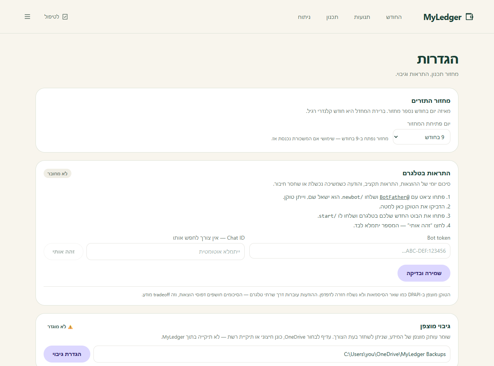

- **יום פתיחת המחזור.**
- **התראות בטלגרם** — חיבור בוט, נמענים נוספים (למשל בן/בת זוג), רמת פירוט, ושליחת סיכום לבדיקה.
- **גיבוי מוצפן** — תיקיית יעד וכמה גיבויים לשמור.
- **מראה** (בתפריט הניהול): בהיר, כהה, או לפי המכשיר.

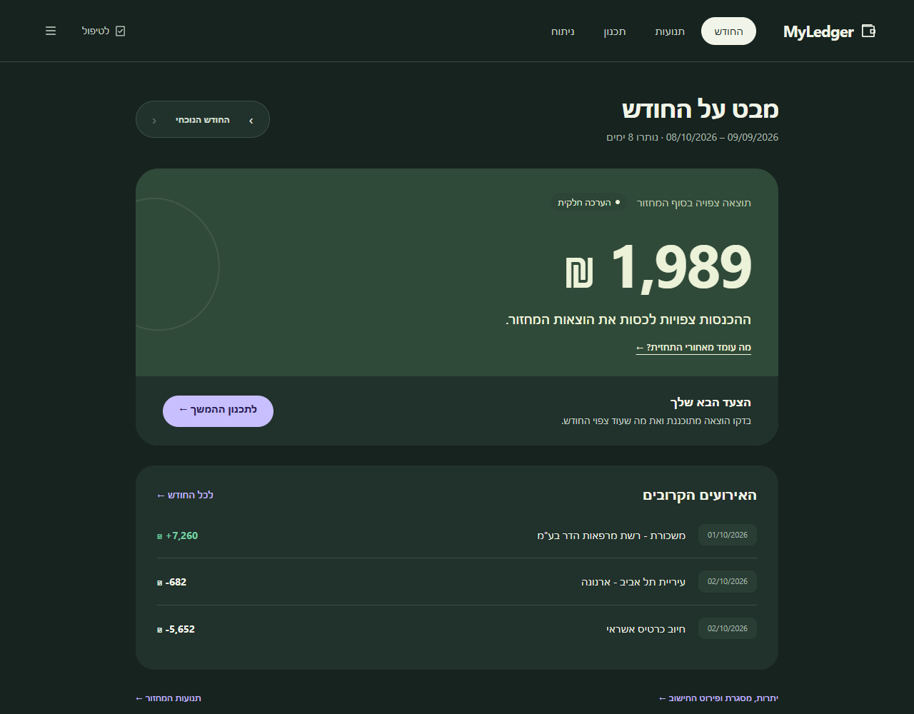

---

## סיכומים בטלגרם

איך יוצרים את הבוט ומחברים אותו, צעד אחרי צעד: [מדריך ההתקנה ← סיכומים בטלגרם](INSTALL.md#סיכומים-בטלגרם).

המשימה היומית שולחת את הסיכום שמתאים לתאריך:

| מתי | מה |
|---|---|
| **1 בחודש** | סיכום חודשי — התוצאה, מול החודש הקודם ומול הממוצע, לאן הלך הכסף ומה משתחרר |
| **יום ראשון** | סיכום שבועי — פילוח לפי קטגוריות ותובנות |
| **שאר הימים** | יומי — הוצאות אתמול, ורק מה שדחוף |

שלוש רמות פירוט: **מלא** (שמות בתי עסק), **בלי שמות** (רק קטגוריות) ו**מינימלי** (רק סכומים). הערוץ יוצא בלבד — אי אפשר לשלוט במערכת מטלגרם.

## שגרת שימוש מומלצת

| מתי | מה | זמן |
|---|---|---|
| כל יום (אופציונלי) | קוראים את הסיכום בטלגרם | 30 שנ׳ |
| פעם בשבוע | **לטיפול** — מסווגים את מה שנשאר, עוברים על התובנות | 3–5 דק׳ |
| לפני הוצאה גדולה | **תכנון** — הסליידר מראה מה יישאר | דקה |
| תחילת חודש | **ניתוח** של החודש שעבר; מעדכנים תקציבים והתחייבויות | 10 דק׳ |

## בטלפון

הממשק רספונסיבי: בטלפון הניווט עובר לתחתית המסך. מכיוון שהשרת מאזין רק למחשב עצמו, מהטלפון מקבלים את **סיכומי הטלגרם** — זה מכוון (ראו [SECURITY.md](../SECURITY.md)).

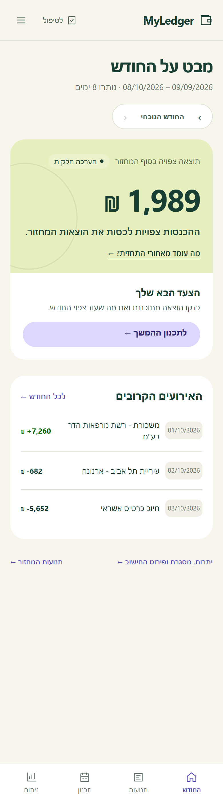 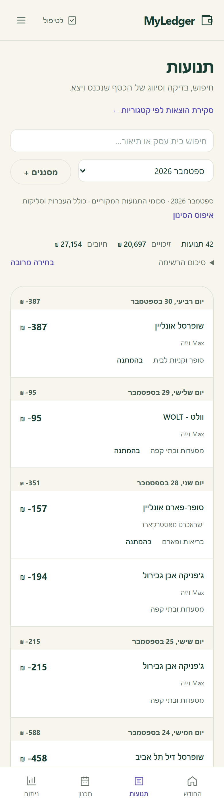

---

## פקודות טרמינל

ארגומנטים נכתבים כמילים אחרי `--`, לא כדגלים: `npm run scrape -- max`.

| פקודה | מה היא עושה |
|---|---|
| `npm run api` | מפעיל את השרת והממשק (http://127.0.0.1:3010) |
| `npm run scrape` | משיכה מכל הספקים שהגיע זמנם · `-- max` ספק אחד · `-- force` כולם |
| `npm run login -- <ספק>` | התחברות ידנית חד-פעמית בדפדפן גלוי (לאתגרי SMS) |
| `npm run accounts` | רשימת חיבורים · `-- add` / `-- update` / `-- remove` |
| `npm run check-config` | בודק את קובץ ההגדרות בלי להציג סיסמאות |
| `npm run audit` | בדיקת ספירה כפולה של חיובי אשראי וכיסוי הנתונים |
| `npm run inspect` | דוח איכות נתונים אחרי חיבור חשבון אמיתי |
| `npm run check:consistency` | מוודא שהסיכומים תואמים בין המסכים |
| `npm run rules:preset` | מחיל מחדש את הקטגוריות והחוקים המוכנים |
| `npm run backup` | גיבוי עכשיו · `-- init` / `-- list` / `-- verify` / `-- restore <file>` |
| `npm run notify` | שולח את סיכום היום בטלגרם · `npm run notify:preview -- monthly` מציג בלי לשלוח |
| `npm run schedule:install` | רישום המשימות היומיות · `:status` / `:check` / `:remove` |
| `npm run secure` / `secure:check` | הקשחה ובדיקת מצב האבטחה |
| `npm run history:prune -- 12` | תצוגה של מחיקת תנועות ישנות מ-12 חודשים · `apply` לביצוע |
| `npm run reset` | מוחק חשבונות ותנועות ושומר קטגוריות וחוקים · `-- all` גם קטגוריות · עם חשבונות אמיתיים דורש גם `force` |
| `npm run seed` | נתוני הדגמה (מסרב אם יש חשבון אמיתי) |
| `npm run llm:bench` | מודד את דיוק המודל המקומי על הסיווגים הקיימים |
| `npm run git:safe-check` | לפני פרסום קוד: סודות ונתונים אישיים בקבצים שיתפרסמו |

